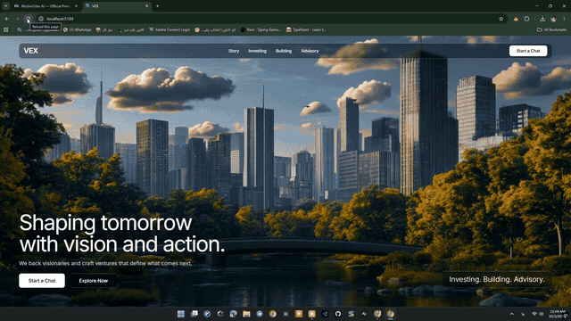

# VEX — Hero Section

A full-screen, cinematic hero section for a fictional venture studio ("VEX") — raw autoplay video background, a liquid-glass navbar and buttons, and a character-by-character animated headline.



## Features

- **Full-bleed video background** — autoplaying, looping, muted, no dark overlay or gradient on top
- **Liquid-glass UI** — navbar, buttons, and the bottom-right tag all share a frosted, blurred glass surface with a subtle gradient border
- **Character-by-character headline animation** — each letter slides in and fades in with a staggered delay
- **Staggered fade-ins** for the subheading, CTA buttons, and tag, timed to land after the headline finishes
- **Responsive layout** — navbar links collapse on mobile, hero content stacks into a single column below the `lg` breakpoint
- Typeset in **Inter**, loaded via Google Fonts and wired through Tailwind's `font-sans`

## Tech stack

- React + TypeScript
- Vite
- Tailwind CSS v4
- lucide-react (icons, available but unused in the current hero)

## Run locally

```bash
npm install
npm run dev
```

Then open the printed local URL in your browser.
